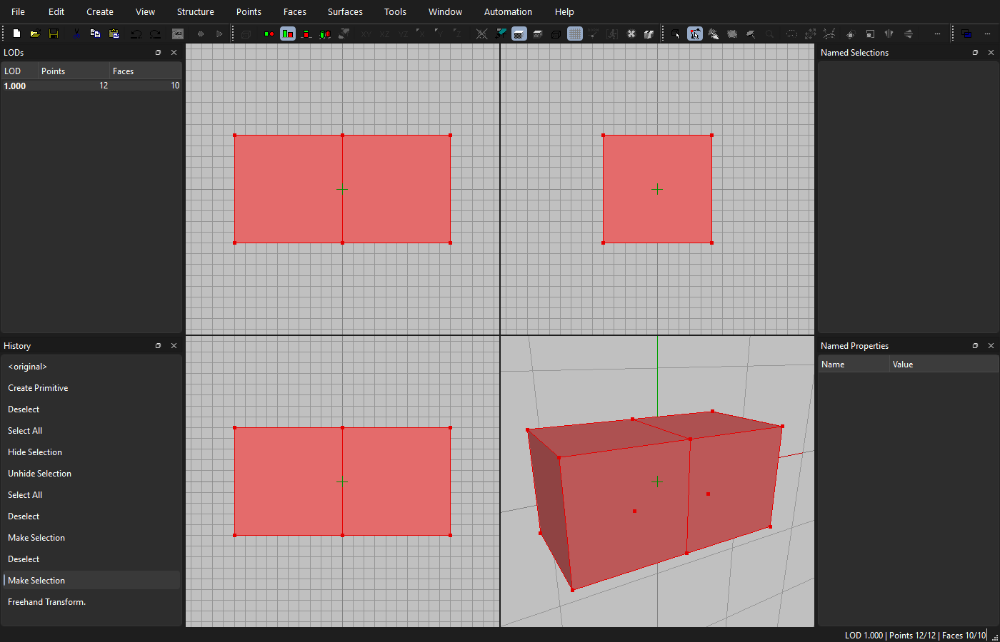
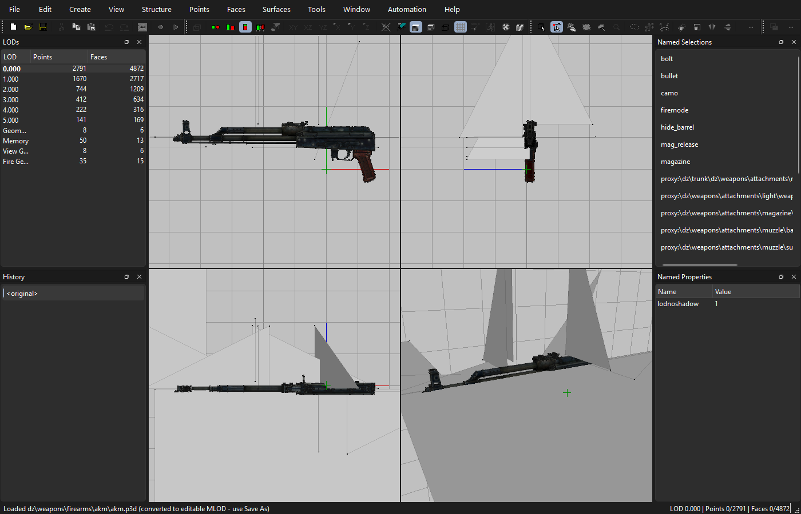

# Object Builder (Qt rebuild)

A Qt 6 / C++17 rebuild of Bohemia Interactive's **Object Builder** (Objektiv2),
reconstructed from the shipped `ObjectBuilder.exe` with REA. It edits editable
MLOD `.p3d` models and keeps the original's menus, shortcuts, toolbar icons,
command IDs and file format, so files round-trip with the original tool.





See [docs/RE_NOTES.md](docs/RE_NOTES.md) for what was recovered from the binary
(file format, flags, LOD names) and [docs/COMMANDS.md](docs/COMMANDS.md) for
which of the original menu commands are implemented.

## Build

Requirements: Qt 6 (Widgets, OpenGL, OpenGLWidgets), CMake ≥ 3.21, a C++17
compiler. With the Qt online installer layout on this machine:

```bash
export PATH="/c/Qt/Tools/mingw1310_64/bin:/c/Qt/Tools/Ninja:/c/Qt/Tools/CMake_64/bin:/c/Qt/6.12.0/mingw_64/bin:$PATH"
cmake -S . -B build -G Ninja -DCMAKE_BUILD_TYPE=Release -DCMAKE_PREFIX_PATH=C:/Qt/6.12.0/mingw_64
cmake --build build
```

Run `build/ObjectBuilderQt.exe [model.p3d]`. Each build copies the Qt and
MinGW runtime DLLs next to the executables (`windeployqt` post-build step), so
they start without Qt on `PATH`.

### JetBrains Rider / Visual Studio

Open `ObjectBuilderQt.sln`. Its projects (`ide/*.vcxproj`) are "Makefile"
projects: Build / Rebuild / Clean run `ide/cmake-build.ps1`, which drives the
same CMake + Ninja + Qt MinGW build as above (Release → `build/`, Debug →
`build-debug/`, configured automatically on first build). `CMakeLists.txt` is
still the only build definition: new source files go there, and the projects
pick up files in `src/core`, `src/app`, `src/ui` by wildcard.

- Projects: `ObjectBuilderQt` (the app), `obcore` (core library),
  `obcore_tests`, `obtool`. Pick one as the run target.
- Compiler errors are reported as `file(line,col): error : ...`, so Rider and
  Visual Studio link them to the source.
- Requires the Visual Studio C++ build tools (for the MSBuild C++ targets);
  the compiler used is still Qt's MinGW. Other Qt/MinGW locations: set the
  `QT_DIR` / `QT_TOOLS` environment variables.
- Breakpoint debugging: the IDEs' Windows debuggers expect MSVC (PDB) builds,
  and MinGW binaries carry GDB debug info, so stepping through code from Rider
  may not work. Running works.

`CMakePresets.json` (presets `release` / `debug`) describes the same setup for
IDEs that open `CMakeLists.txt` directly.

## Tests

```bash
build/obcore_tests.exe                            # format round-trip, geometry ops, LOD names, FBX, PAA
build/ObjectBuilderQt.exe --selftest out_dir       # drives menu commands + mouse, saves screenshots
build/ObjectBuilderQt.exe --list-commands docs/COMMANDS.md   # regenerate the coverage table
build/ObjectBuilderQt.exe --screenshot "dz\weapons\firearms\akm\akm.p3d" akm.png   # textured capture
build/obcore_tests.exe --write-sample sample.p3d   # small multi-LOD model for manual testing
build/obtool.exe odol-scan "C:/Program Files (x86)/Steam/steamapps/common/DayZ"   # convert every game model
node tests/make_test_fbx.js tests/data             # regenerate the FBX fixtures
```

`obtool` is a developer CLI: `pbo-list`, `extract`, `paa` (to PNG), `odol`
(convert one binarized model to MLOD), `odol-scan`, `fbx`, `obj` (export one
LOD to OBJ) and `orient` (per-LOD report: closed parts facing outward/inward,
stored normals matching the original's direction, bounding box). `orient`
accepts P3D, binarized P3D, OBJ and FBX files, so it can check models that
went through Blender and back.

## Importing models

- **Game models** - *File > Open from Game Data...* (Ctrl+Shift+O) lists every
  `.p3d` in the DayZ archives (14,688 in the current game) with a filter box.
  *File > Open* also accepts binarized `.p3d` files on disk. Binarized (ODOL)
  models are converted to editable MLOD: all LODs, faces, UVs (all sets),
  textures and materials, named selections (with weights), named properties,
  proxies, keyframe phases, sharp edges and geometry mass. The result has no
  file name yet, so *Save* asks where to write the editable copy.
  The original Object Builder cannot do this; see RE_NOTES section 8.
- **FBX** - *File > Import > FBX File...* (binary 7.x or ASCII, no Autodesk
  SDK needed). Units become metres; axes become Y-up left-handed. LODs come from
  a LodGroup (children in order or by LOD name) or from node names
  ("Geometry", "Memory", "1.000", "LOD 2", ...). Every mesh becomes a named
  selection. Materials named `*.rvmat` become face materials.
  - **Textures**: each material's diffuse / base colour texture becomes the
    face texture (normal, specular and other maps are ignored). The file is
    looked for at the absolute path stored in the FBX, the relative path, and
    by name in the FBX's folder, its `textures` folder and `<name>.fbm`.
    Textures embedded in the FBX (Blender: *Path Mode: Copy* + *Embed
    Textures*) are saved to `<name>.fbm` next to the FBX when no file is
    found. When a converted `.paa` sits next to the image (`x_co.png` →
    `x_co.paa`), the `.paa` is used. Files inside an unpacked mod (a folder
    above them has `$PBOPREFIX$`) are stored as game paths
    (`<prefix>\data\x_co.paa`), files on the work drive `P:`-relative; others
    keep their absolute path so they still display after the model is saved
    elsewhere. The status bar reports textures found, extracted and missing.
    PNG/TGA/JPG textures display in the viewport; the game itself needs `.paa`
    (convert with DayZ Tools' ImageToPAA; re-import or retarget afterwards).
    Partly transparent textures (`_ca`) display blended.
  - **Materials**: name the Blender/Max material after its `.rvmat`
    (`mymod\data\gun.rvmat`). Blender's duplicate-name suffix
    (`gun.rvmat.001`, for a second material sharing the `.rvmat`) is ignored.
  - **Proxies**: an object named `proxy:<path>.<n>` (e.g.
    `proxy:\dz\weapons\attachments\optics\optic_acog.001`) becomes a proxy:
    its faces get no texture/material and its points the proxy flag.
  - Blender cannot hold two faces on the same vertices, so double-sided faces
    that share vertices (and overlay layers) are merged on its side.
- **OBJ** - *File > Import > OBJ File...* (`usemtl` names that look like
  texture paths become face textures; this is how *Export OBJ* writes them).

Game data is found automatically (default
`C:\Program Files (x86)\Steam\steamapps\common\DayZ`; a `P:\` work drive is
used when present). Both locations can be changed in *File > Options...*
("DayZ folder", "Work drive (P:)"). The archives are indexed in the background
at start-up (about a second).

## Textures

*View > Show Textures* (Ctrl+Alt+T; on by default) draws faces textured in solid
mode (*View > Solid Fill Faces*). Textures are looked up as procedural
`#(argb,...)color(...)`, absolute path, next to the model, in the model's mod
folder, on the work drive, then inside the game archives. The mod folder is
found from the folders above the model: a `$PBOPREFIX$` file maps its prefix
to its folder, and every parent folder is also tried as a root. So an unpacked
mod such as `Desktop\dz_export\StalkerFWWeapons\rifles\ak103\ak103.p3d` finds
`stalkerfwweapons\rifles\ak74\data\ak101_co.paa` without a P: drive.
`build/obtool.exe textures <model>` lists every texture and whether it is
found. `.paa`/`.pac` files are decoded (DXT1/3/5,
ARGB4444/1555/8888, AI88, LZO/LZSS mipmaps); `.png`/`.tga`/`.jpg` work too.
Decoding runs in the background. *View > Reload Textures* refreshes after you
change a texture file.

## What works

- **File**: New, Open, Save, Save As, Merge, Merge As Selection, recent files,
  Import OBJ, Export OBJ, Export P3D Old Version (SP3X), Options.
- **Data**: multiple LODs (special LOD names), points/faces with flags,
  textures/materials, named selections (weighted), named properties, sharp
  edges, mass, UV sets, animation phases, hidden/locked parts.
- **Editing**: undo/redo for every change (History panel), cut/copy/paste,
  delete, selection tools and selection operators, hide/lock, pin.
- **Create**: point, plane, box, circle, cylinder, sphere, face from points,
  proxy, extrude.
- **Structure/Points/Faces/Surfaces**: triangulate, squarize, find components,
  find non-closed, check/repair degenerated faces, center all, move, rotate,
  scale, merge, merge near, isolated points, reverse, uncross, remove, face
  order, recalculate normals, sharp/smooth edges, UV set add/delete/ID/activate,
  Face Properties and Point Properties dialogs.
- **View**: four views (Front, Left, Top, Projected) or one; any view can be
  switched to Front/Back/Left/Right/Top/Bottom/Projected; wireframe or solid,
  face culling, grid, zoom to drawing/selection.

Commands not yet implemented stay in the menus, disabled, with
"(not implemented yet)" in the status tip.

## Mouse

| Action | Effect |
|---|---|
| Left drag / click | Select (mode from Edit > Edit Modes: vertices, faces, object) |
| Shift / Ctrl + left | Add to / remove from selection |
| Alt + left drag | Move selection in the view plane |
| Alt + Shift + left drag | Rotate selection around the pin |
| Alt + Ctrl + left drag | Scale selection around the pin |
| Left click in "Move pin" mode | Place the pin |
| Right drag | Orbit (Projected view) / pan (2D views); Shift+right pans in 3D |
| Middle drag | Pan |
| Wheel | Zoom (towards the cursor in 2D views) |
| Right click | Edit menu |

Keyboard shortcuts are the original accelerators (e.g. F2 object, F3 faces,
F4 vertices, Ctrl+A select all, Del delete, E face properties, Shift+E point
properties).

## Project layout

```
src/core/      no-UI library (obcore): data model, file formats, primitives, mesh ops
  ObjectData     one LOD: points, faces, selections, properties, UV sets, mass...
  LodObject      the model (sorted LODs) + LOD naming
  P3dIO          MLOD reader/writer (byte-exact round trip)
  Odol           binarized model (ODOL v28-55) reader -> MLOD
  FbxIO, ObjIO   importers
  Pbo            PBO archives + GameFileSystem (indexed game data)
  Paa            texture decoding; Compression: LZO1X and BI LZSS
  TextureLibrary texture path resolution and cache
  MeshOps        topology/geometry operations used by commands
src/app/       Document (model + undo), CommandRegistry, command handlers, GameData
  Commands*.cpp  one file per menu group; each registers handlers by command ID
src/ui/        MainWindow, Viewport (OpenGL), dock panels, dialogs, UiSpec loader
resources/     ui_spec.json + toolbar bitmaps generated from the original exe
tools/         gen_ui_spec.js (regenerates resources from ObjectBuilder.exe)
tests/         core tests, obtool CLI, fixtures in tests/data (FBX incl. a Blender export with embedded textures, binarize.exe box pair)
```

## Adding a feature

Every menu item already has an action built from the original resources; it
becomes active as soon as a handler with its ID is registered.

1. Find the command ID in [docs/COMMANDS.md](docs/COMMANDS.md) (or add a named
   constant to `src/app/CommandIds.h`).
2. Put the logic in `src/core/` when it is geometry/data work (testable without
   UI), e.g. a new function in `MeshOps`.
3. Register the handler in the matching `src/app/Commands*.cpp`:

   ```cpp
   r.add({Cmd::FaceSort,                       // 32950, Faces > Sort
          [=] { d->editActive(QObject::tr("Sort"), MeshOps::sortFaces); },
          selFaces});                          // optional enabled() predicate
   ```

   `Document::editActive` (one LOD) and `Document::editAll` (whole model) put
   the change on the undo stack automatically. Pass an enabled predicate and,
   for toggles, a `checked` predicate.
4. A brand-new command that the original did not have uses an ID ≥ 40000 and
   says where it goes:

   ```cpp
   r.add({40010, run, {}, {}, QStringLiteral("&Tools"), QObject::tr("My Tool..."), QKeySequence("Ctrl+Alt+M")});
   ```

5. Add a check to `src/app/SelfTest.cpp` or `tests/core_tests.cpp` and rerun
   `--list-commands` to update the coverage table.
